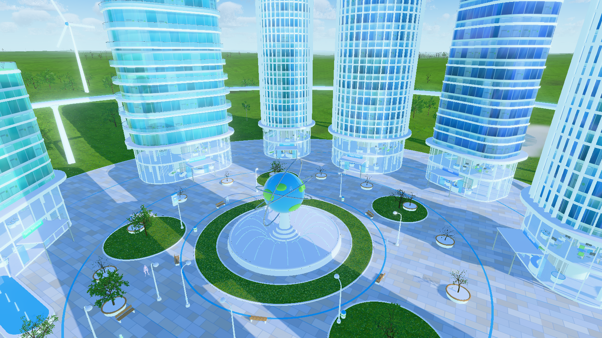

# Frutiger Aero Chillroom

Eine detaillierte 3D-Welt im **Frutiger-Aero**-Stil (ca. 2005–2013): spiegelnde Glastürme, Wasser,
sattgrüne Wiesen, ein blauer Himmel mit hohen Haufenwolken und eine durchsichtige Glasfigur,
die durch die Landschaft läuft. Gebaut mit [Three.js](https://threejs.org/) und [Vite](https://vitejs.dev/).

## Screenshots

| Überblick | Spielansicht |
| --- | --- |
|  |  |
| **See** | **Stadt** |
|  |  |
| **Platz von oben** | **Glasfigur** |
|  |  |
| **Lobby (Erdgeschoss)** | **Erster Stock** |
|  |  |
| **Gras aus Bodenhöhe** | |
|  | |

## Starten

```bash
npm install
npm run dev          # Welt im Browser ansehen (Maus: drehen/zoomen)
npm run screenshots  # Screenshots neu rendern -> screenshots/
```

Eine einzelne Ansicht direkt öffnen: `http://localhost:5173/?shot=lobby`
(Namen siehe `src/shots.js`).

## Was drin ist

- **Himmel**: raymarchte, volumetrische Cumulus-Wolken in 1.200–3.300 m Höhe (Perlin-Worley-Rauschen,
  Selbstschatten, leicht bewölkt), Sonne mit Lens-Flare.
- **Landschaft**: weite, flache Hügel bis zum Horizont; nahes Gelände detailliert, Fernbereich grob.
  Bodenshader mit Foto-Grastextur (zwei Maßstäbe, gegen Kachel-Wiederholung), Sand, Erde, Seegrund.
- **Gras**: ~600.000 texturierte Grasbüschel mit Wind, in 32-m-Kacheln mit Sichtweiten-Grenze.
- **Bäume**: prozedurale Bäume mit echten Rinden- und Blatttexturen (Eiche, Esche, Espe, Kiefer, Büsche),
  instanziert, mit Detailstufe nah/fern und Fernwäldern auf den Hügeln.
- **Wasser**: spiegelnder See mit Wellen-Normalen und Fischen.
- **Stadt**: 8 Hochhäuser (rund, Wellen-Balkone, verdrehter Turm, Terrassen-Turm, Zwillingstürme
  mit Skybridges), Fassaden mit Fensterraster, beleuchteten Büros, Etagenbändern, Lamellen,
  Dachgärten und Turmspitzen. Die Glastürme spiegeln die echte Stadt.
- **Begehbare Gebäude**: Erdgeschoss-Lobby (Glaswände, offene Schiebetüren, Vordach, Rezeption,
  Aufzüge, Lounge, Säulen, Pflanzen, Bildschirm) und erster Stock (Treppe, Co-Working-Tische,
  Café, gläserner Besprechungsraum).
- **Platz**: Globus-Brunnen mit Wasserbögen, Rasenflächen, Boulevard mit Laternen, Bänken,
  Baumkübeln, Info-Terminals, Wasserbecken, Ringbahn mit Station und Zug, Biodom.
- **Glasfiguren**: durchsichtige, schillernde Figuren mit Rand-Glow und leuchtendem Kern,
  animiert (idle/walk/run) — Spielfigur und Passanten.

## Aufbau

- `src/main.js`: Szene, Licht, Nachbearbeitung, Kamera
- `src/world/sky.js`, `cloudNoise.js`: Himmel und volumetrische Wolken
- `src/world/terrain.js`: Höhenfunktion, Bodenshader, Weg
- `src/world/grass.js`, `trees.js`, `nature.js`: Gras, Bäume, Verteilung
- `src/world/water.js`: Wasser und Fische
- `src/world/character.js`: Glasfiguren
- `src/world/city/`: Hochhaus-Generator (`tower.js`), Bauteile und Möbel (`parts.js`),
  Stadtmöbel (`props.js`), prozedurale Texturen (`textures.js`), Stadtplan (`city.js`)
- `src/world/buildings.js`: Öko-Häuser und Windräder
- `src/shots.js`: Kamerapositionen für die Screenshots

## Asset-Quellen

- Bäume, Rinden-/Blatttexturen, Bodentextur, Grasbüschel, Erde: [EZ-Tree](https://github.com/dgreenheck/ez-tree)
  von Daniel Greenheck (MIT; Rinden teils von Poly Haven/TextureCan).
- `Xbot.glb` (Figur mit Animationen), `waternormals.jpg`, `grasslight-big.jpg`: aus den
  [Three.js-Beispielen](https://github.com/mrdoob/three.js/tree/dev/examples). Xbot stammt ursprünglich
  von Mixamo; für eine Veröffentlichung des Spiels sollte die Lizenz geprüft oder die Figur ersetzt werden.
