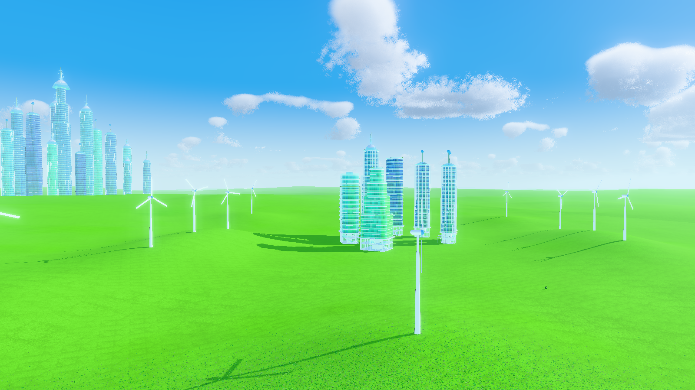
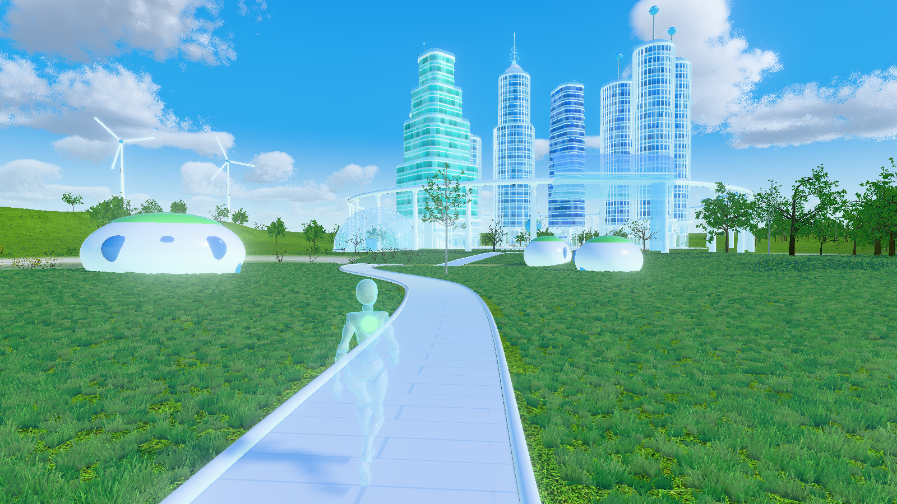
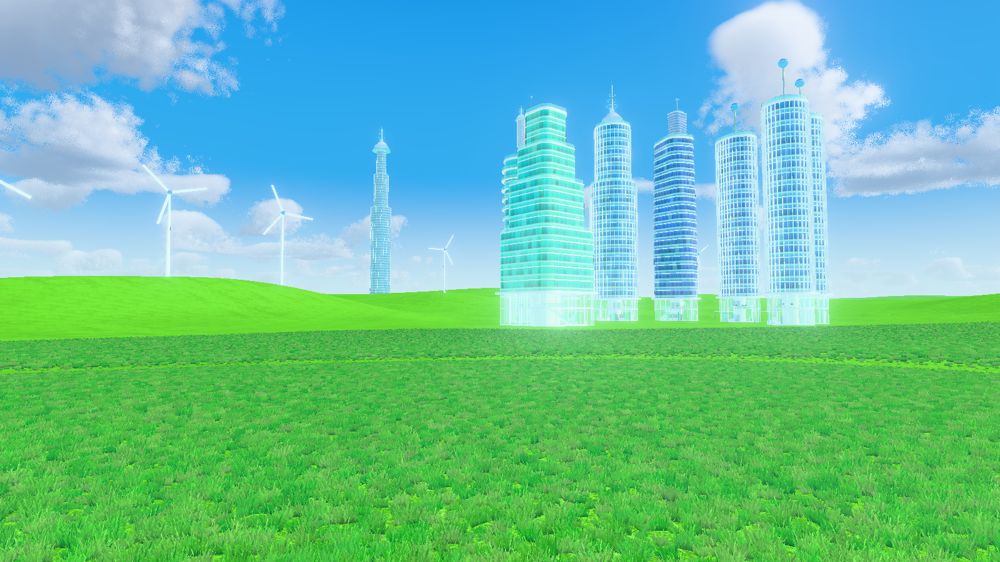
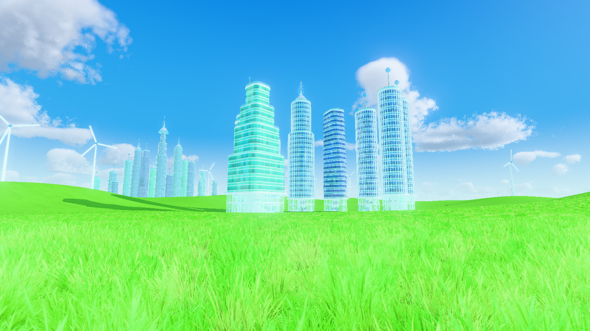
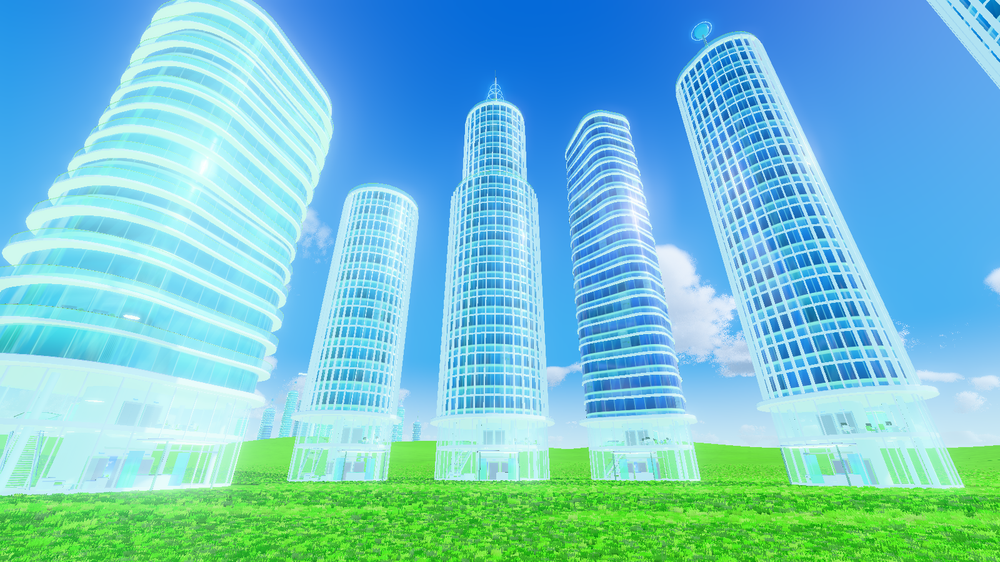
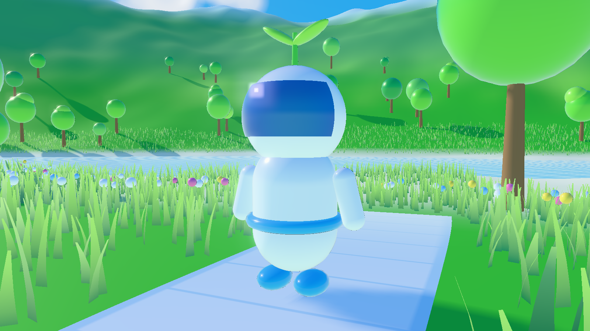
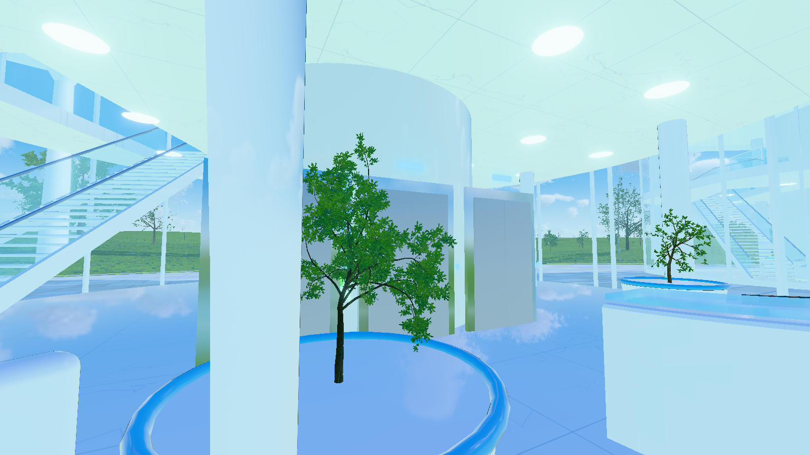
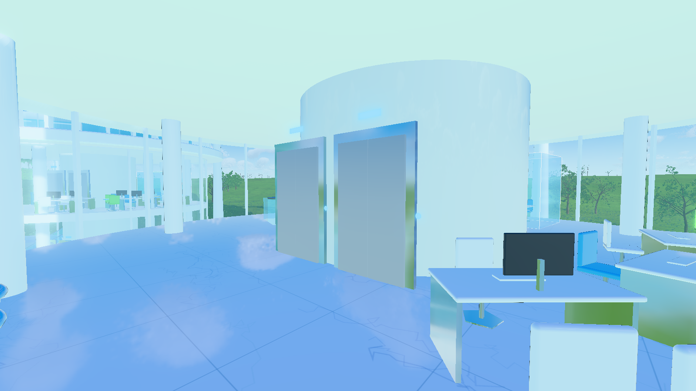

# Frutiger Aero Chillroom

Eine 3D-Traumwiese im **Frutiger-Aero**-Stil (ca. 2005–2013): knallgrünes Gras auf sanft fließenden
Hügeln, ein Block spiegelnder Glashochhäuser, Windräder, hohe Haufenwolken und glänzende
„Buddy“-Figuren im Stil der alten Messenger-Icons. In der Ferne ragt eine Skyline aus riesigen
Türmen hinter den Hügeln hervor, die man nie erreicht. Gebaut mit [Three.js](https://threejs.org/) und [Vite](https://vitejs.dev/).

## Screenshots

| Überblick | Spielansicht |
| --- | --- |
|  |  |
| **Horizont** | **Gras aus Bodenhöhe** |
|  |  |
| **Zwischen den Hochhäusern** | **Spielfigur** |
|  |  |
| **Lobby (Erdgeschoss)** | **Erster Stock** |
|  |  |

## Starten

```bash
npm install
npm run dev          # Welt im Browser ansehen (Maus: drehen/zoomen)
npm run screenshots  # Screenshots neu rendern -> screenshots/
```

Eine einzelne Ansicht direkt öffnen: `http://localhost:5173/?shot=lobby`
(Namen siehe `src/shots.js`). Farbe der Spielfigur wählen: `?figur=blau` (blau, rot, gold, tuerkis,
gruen, pink, glas).

## Was drin ist

- **Wiese**: weite, fließende Hügel bis zum Horizont, Boden mit neongrün eingefärbter Foto-Grastextur.
- **Gras**: dichtes, texturiertes Gras mit Wind, das mit der Kamera „mitwandert“: zwei Raster aus
  Grasbüscheln (nah sehr dicht, weiter weg gröber), die der Shader um die Kamera legt. Überall dicht,
  bei konstanten Kosten.
- **Unsichtbare Übergänge**: Grasbüschel dünnen zum Rand zufällig aus statt in einem Ring zu enden,
  Gras wird mit der Geländeneigung beleuchtet und ist farblich auf den Boden abgestimmt, die
  Bodentextur beruhigt sich mit der Entfernung, und der Schattenbereich reicht über das Bild hinaus.
- **Himmel**: raymarchte, volumetrische Cumulus-Wolken in 1.200–3.300 m Höhe (leicht bewölkt),
  Sonne mit Lens-Flare, heller Dunst.
- **Hochhausblock** (begehbar): 8 Türme direkt im Gras, mit spiegelnden Fassaden, Etagenbändern,
  Lamellen, Wellen-Balkonen, verdrehtem Turm, Terrassen, Zwillingstürmen mit Skybridges.
  Erdgeschoss-Lobby und erster Stock mit Einrichtung.
- **Skyline**: 16 riesige Türme dicht beieinander am Horizont, deren Fuß hinter den Hügeln verborgen ist.
- **Windräder** auf den Hügeln.
- **Buddy-Figuren**: runder Kopf auf glockenförmigem Körper mit weichen Falten, glänzender
  Candy-Metallic-Lack in sieben Farben. Prozedural animiert: Atmen, Watscheln, Hüpfen.

## Aufbau

- `src/main.js`: Szene, Licht, Nachbearbeitung, Kamera
- `src/world/layout.js`: Startpunkt, Hochhausblock, Windräder
- `src/world/sky.js`, `cloudNoise.js`: Himmel und volumetrische Wolken
- `src/world/terrain.js`: Höhenfunktion und Bodenshader
- `src/world/grass.js`: mitwanderndes Gras
- `src/world/character.js`: Buddy-Figuren
- `src/world/city/`: Hochhaus-Generator (`tower.js`), Bauteile und Möbel (`parts.js`),
  prozedurale Texturen (`textures.js`), Hochhausblock und Skyline (`city.js`)
- `src/world/buildings.js`: Windräder
- `src/shots.js`: Kamerapositionen für die Screenshots

## Asset-Quellen

- Bodentextur und Grasbüschel: aus [EZ-Tree](https://github.com/dgreenheck/ez-tree) von Daniel Greenheck (MIT).
- `grasslight-big.jpg`: aus den [Three.js-Beispielen](https://github.com/mrdoob/three.js/tree/dev/examples) (MIT).
- Figuren, Hochhäuser und Wolken sind komplett im Code erzeugt.
