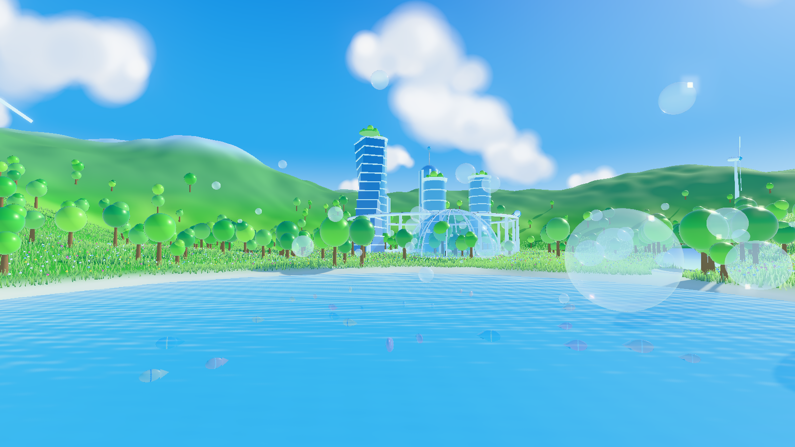
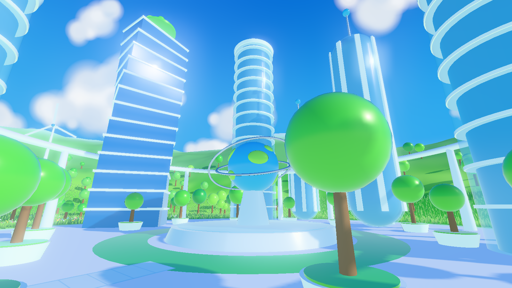

# Frutiger Aero Chillroom

Eine 3D-Welt im **Frutiger-Aero**-Stil (ca. 2005–2013): glänzendes Glas, Wasser, Seifenblasen,
sattgrüne Wiesen, blauer Himmel mit Wolken und eine kleine Figur, die durch die Landschaft läuft.
Gebaut mit [Three.js](https://threejs.org/) und [Vite](https://vitejs.dev/).

## Screenshots

| Überblick | Spielansicht |
| --- | --- |
|  |  |
| **See** | **Stadt** |
|  |  |


## Starten

```bash
npm install
npm run dev          # Welt im Browser ansehen (Maus: drehen/zoomen)
npm run screenshots  # Screenshots neu rendern -> screenshots/
```

## Aufbau

- `src/world/terrain.js`: Höhenfunktion, Gelände und weißer Weg
- `src/world/sky.js`: Himmelsverlauf, Sonne und Wolken
- `src/world/grass.js`: Gras im Wind (instanziert)
- `src/world/water.js`: Wasser, Fische und schillernde Seifenblasen
- `src/world/buildings.js`: Glastürme, Biodom, Globus-Brunnen, Monorail, Öko-Häuser, Windräder
- `src/world/nature.js`: Bäume und Blumen
- `src/world/character.js`: die Spielfigur (mit Lauf-Animation als Vorbereitung fürs Spiel)
- `src/world/layout.js`: wo was in der Welt liegt
- `src/shots.js`: Kamerapositionen für die Screenshots (`?shot=ueberblick` usw.)
